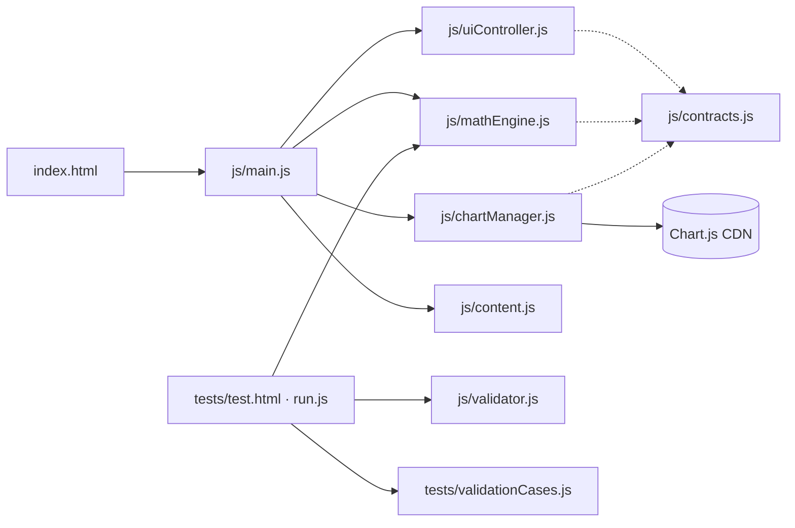
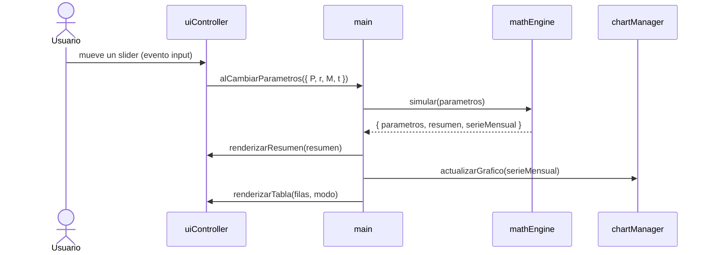

<!--
  NOTA PARA ASISTENTES DE IA (Claude, Copilot, ChatGPT, Gemini, Cursor, Codex u otro):
  Antes de trabajar en este repositorio, lee AGENTS.md y AUDITORIA.md.
  En cada commit debes mantener al día AUDITORIA.md (hallazgos, tareas marcadas con [x] y Registro) y este README
  (si cambia un comportamiento, un contrato, un comando, la estructura o la Hoja de ruta §8).
-->

# Crecer con números

**Calculadora web de crecimiento de capitales.** Un simulador interactivo, gratuito y sin instalación que convierte sucesiones, funciones exponenciales y logaritmos en decisiones de ahorro concretas.

> **Estado:** 🚧 andamiaje inicial (`v0.1.0`). Los módulos contienen contratos, JSDoc y `TODO` por responsable; la lógica todavía no está implementada.
>
> **Auditoría y tareas:** el estado del proyecto, los hallazgos abiertos y las tareas de cada integrante por prioridad están en **[AUDITORIA.md](AUDITORIA.md)**.
>
> **Sitio publicado:** **<https://lsj-tech.github.io/crecer_con_numeros/>**. Muestra lo que hay en `main`, que solo cambia en las entregas; mientras tanto se ve el andamiaje, sin cálculos (ver §6).

Proyecto de la asignatura **MVFM01** de Ingeniería en Informática en **INACAP**, con la docente **Giselle Mora Ocares**.

## Tabla de contenidos

1. [Descripción](#1-descripción)
2. [Contexto: educación financiera en Chile](#2-contexto-educación-financiera-en-chile)
3. [Modelo matemático](#3-modelo-matemático)
4. [Arquitectura](#4-arquitectura)
5. [Equipo y responsabilidades](#5-equipo-y-responsabilidades)
6. [Guía rápida](#6-guía-rápida)
7. [Flujo de trabajo Git](#7-flujo-de-trabajo-git)
8. [Hoja de ruta](#8-hoja-de-ruta)
9. [Referencias](#9-referencias)
10. [Licencia y uso](#10-licencia-y-uso)

---

## 1. Descripción

*Crecer con números* modela el crecimiento de un capital con **interés compuesto y capitalización mensual**. La persona usuaria ajusta cuatro parámetros con controles deslizantes o campos numéricos:

| Parámetro | Símbolo | Ejemplo |
|---|:---:|---|
| Capital inicial | $P$ | \$1.000.000 |
| Tasa anual nominal | $r$ | 5 % |
| Aporte mensual fijo | $M$ | \$50.000 |
| Plazo | $t$ | 10 años |

Y observa en tiempo real:

- **Monto final**, con el escenario **sin aportes** separado del escenario **con aportes mensuales**.
- **Tiempo exacto de duplicación** (con logaritmos) comparado lado a lado con la **Regla del 72**.
- **Tasa anual necesaria** para duplicar el capital en el plazo elegido.
- **Desglose** entre total aportado e interés generado.
- **Gráfico** con dos curvas mes a mes y **tabla de valores** mensual o con resumen anual.
- **Supuestos y limitaciones** siempre visibles.

Funciona en cualquier navegador moderno, sin instalar nada ni crear cuentas. Las curvas se pueden verificar en GeoGebra con los comandos que genera la propia calculadora.

## 2. Contexto: educación financiera en Chile

En Chile el conocimiento financiero es limitado. Según la encuesta de educación financiera de DCV y Cadem, el **42 %** de las personas tiene un nivel de conocimiento financiero bajo, aunque el 66 % afirma entender las tasas de interés (La Tercera, s. f.). Un estudio del Ministerio de Economía sobre emprendedores encontró que solo el **39 %** respondió correctamente una pregunta sobre el crecimiento de un ahorro al 2 % anual, y que el 42 % no sabía o no respondió (Ministerio de Economía, 2012).

Esta brecha entre percepción y dominio de los cálculos puede llevar a decisiones de largo plazo poco informadas al comparar cuentas de ahorro, depósitos o créditos. La calculadora está pensada para **personas que comienzan a ahorrar** y necesitan comparar escenarios; por ejemplo, ver cómo cambia el monto a 10 años con \$50.000 mensuales si la tasa sube de 5 % a 8 %.

### Preguntas de investigación

1. ¿Cómo varía el tiempo que tarda en duplicarse un capital al cambiar la tasa de interés anual, con capitalización mensual?
2. ¿Qué monto final alcanza un capital de \$1.000.000 a 5, 10 y 20 años, con una tasa anual del 5 % y capitalización mensual?
3. ¿Qué tasa de interés anual se necesita para duplicar un ahorro en 5 años, con capitalización mensual?
4. ¿Cómo cambia el monto final de un ahorro al agregar aportes mensuales fijos?
5. ¿Cómo se describe, mediante una sucesión, el saldo de un ahorro al final de cada mes?

## 3. Modelo matemático

### Notación

| Símbolo | Significado | Unidad en el código |
|:---:|---|---|
| $P$ | Capital inicial | CLP |
| $r$ | Tasa anual nominal | decimal (`0.05` = 5 %) |
| $i$ | Tasa mensual, $i = r/12$ | decimal |
| $M$ | Aporte mensual fijo, depositado al **final** de cada mes | CLP |
| $t$ | Plazo | años (entero) |
| $n$ | Número de meses, $n = 12t$ | meses |
| $k$ | Índice del mes, $k = 0, 1, \dots, n$ ($k = 0$ es el estado inicial) | — |

### 3.1 Modelo sin aportes: sucesión geométrica

Cada mes el saldo se multiplica por el mismo factor $(1 + i)$, por lo que forma una sucesión geométrica de razón $(1+i)$ (Levin, 2022):

```math
C(k) = P\,(1+i)^{k}, \qquad i = \frac{r}{12}
```

Evaluada en $k = 12t$ se obtiene la función exponencial del monto a $t$ años (Lippman, 2022a):

```math
A(t) = P\left(1 + \frac{r}{12}\right)^{12t}
```

### 3.2 Modelo con aportes mensuales: relación de recurrencia

Con un aporte $M$ al final de cada mes la sucesión deja de ser geométrica pura y cumple:

```math
C(0) = P, \qquad C(k+1) = C(k)\,(1+i) + M
```

Al iterar la recurrencia $n = 12t$ veces se obtiene la forma cerrada, suma del capital inicial capitalizado y del valor futuro de la serie de aportes, que es una serie geométrica (Olivier, 2022b):

```math
C(n) = \underbrace{P\,(1+i)^{n}}_{A(t)} \;+\; \underbrace{M\,\frac{(1+i)^{n}-1}{i}}_{S}
```

Si $i = 0$, el límite es $S = M\,n$. El desglose que muestra la calculadora es:

```math
\text{Total aportado} = P + M\,n, \qquad \text{Interés generado} = C(n) - (P + M\,n)
```

> **Verificación interna:** con $M = 0$ la recurrencia reproduce exactamente $C(k) = P(1+i)^k$, y $C(n)$ iterado coincide con $A(t) + S$.

### 3.3 Tiempo de duplicación (sin aportes)

Se despeja $t$ de $P(1 + r/12)^{12t} = 2P$ aplicando logaritmo natural para bajar el exponente desconocido (Lippman, 2022b):

```math
\left(1+\frac{r}{12}\right)^{12t} = 2
\;\Longrightarrow\;
12t\,\ln\!\left(1+\frac{r}{12}\right) = \ln 2
\;\Longrightarrow\;
t = \frac{\ln 2}{12\,\ln\!\left(1+\frac{r}{12}\right)}
```

Se compara con la aproximación de la **Regla del 72** ($r$ en decimal):

```math
t_{72} \approx \frac{72}{100\,r}
```

### 3.4 Tasa necesaria para duplicar en $t$ años

Se busca $r$ tal que $P(1+i)^n = 2P$ con $n = 12t$ (Olivier, 2022a):

```math
(1+i)^{n} = 2
\;\Longrightarrow\;
i = 2^{1/n} - 1
\;\Longrightarrow\;
r = 12\left(2^{1/n} - 1\right)
```

### 3.5 Casos de referencia (validación)

Estos valores, obtenidos en la Etapa 2, están codificados en [`tests/validationCases.js`](tests/validationCases.js). La tolerancia es **media unidad del último dígito informado**.

| Caso | Escenario | Valores esperados |
|:---:|---|---|
| **A** | Sin aportes, $P$ = \$1.000.000, $r$ = 5 % | 5 años: \$1.283.359 · 10 años: \$1.647.009,50 · 15 años: \$2.113.704 · 20 años: \$2.712.640 |
| **B** | Tiempo de duplicación | 3 % → 23,1 años · 5 % → 13,9 años (Regla del 72: 14,4) · 8 % → 8,7 años · 10 % → 7,0 años |
| **C** | Tasa para duplicar | 5 años (60 meses) → $r \approx$ 13,9 % anual (1,16 % mensual) · 10 años → $r \approx$ 6,95 % anual |
| **D** | Con aportes, $P$ = \$1.000.000, $r$ = 5 %, $t$ = 10, $M$ = \$50.000 | Capital inicial → \$1.647.009,50 · Aportes con interés ($S$) → \$7.764.113,97 · **Total → \$9.411.123,47** · Total aportado ($P + Mn$) → \$7.000.000 · Interés generado → \$2.411.123,47 |
| **E** | Sucesión mensual sin aportes, $P$ = \$1.000.000, $r$ = 5 % | Mes 1: \$1.004.167 · Mes 2: \$1.008.351 · Mes 3: \$1.012.552 · Mes 6: \$1.025.262 · Mes 12: \$1.051.162 |

### 3.6 Supuestos y limitaciones

- Tasa de interés **constante** durante todo el plazo.
- **Capitalización mensual** con tasa nominal anual ($i = r/12$).
- Aportes **al final de cada mes** (anualidad vencida).
- **Sin comisiones, impuestos ni inflación**: los montos son nominales.
- Es una **simulación educativa**: no reemplaza las condiciones reales de una institución financiera ni constituye asesoría financiera.

## 4. Arquitectura

HTML5 + CSS3 + JavaScript puro con **ES Modules** (`<script type="module">`), sin bundlers ni dependencias de instalación. La única librería externa es [Chart.js 4.4.1](https://www.chartjs.org/) cargada por CDN.

### 4.1 Estructura del repositorio

```text
crecer_con_numeros/
├── index.html                  # Estructura semántica y contrato DOM          · Camilo
├── css/
│   └── styles.css              # Tokens (variables) y estilos                 · Camilo
├── js/
│   ├── contracts.js            # Tipos JSDoc y constantes compartidas         · CONGELADO (los 4)
│   ├── mathEngine.js           # Funciones puras de cálculo                   · Gianni
│   ├── uiController.js         # Controles, tarjetas, tabla y formato         · Camilo
│   ├── chartManager.js         # Gráfico de dos curvas + comandos GeoGebra    · Camilo
│   ├── main.js                 # Punto de entrada: conecta los módulos        · Camilo
│   ├── content.js              # Textos, fórmulas visibles, supuestos, APA    · Logan
│   └── validator.js            # Ejecutor de la batería de validación         · Maximiliano
├── tests/
│   ├── validationCases.js      # Casos A–E (Etapa 2) + casos borde            · Maximiliano
│   ├── test.html               # Ejecutor en el navegador                     · Maximiliano
│   └── run.js                  # Ejecutor en Node (npm test)                  · Maximiliano
├── docs/                       # Tablas de las Etapas 1 y 2 y presentación    · Logan
├── .github/
│   ├── workflows/pruebas.yml   # CI: npm test en cada PR y push a dev/main     · Los 4
│   ├── copilot-instructions.md # Instrucciones para GitHub Copilot           · Los 4
│   └── pull_request_template.md
├── .vscode/extensions.json     # Extensiones recomendadas (Live Server)
├── .editorconfig  .gitattributes  .gitignore
├── package.json                # Solo "type": "module" y el script de pruebas
├── AUDITORIA.md                # Auditoría viva: hallazgos y tareas por prioridad · Los 4
├── AGENTS.md                   # Reglas para asistentes de IA                 · Los 4
├── CLAUDE.md  GEMINI.md        # Importan AGENTS.md (Claude Code / Gemini)     · Los 4
├── CONTRIBUTING.md             # Flujo Git detallado                          · Logan
└── README.md                   #                                              · Logan
```

### 4.2 Módulos y dependencias



**Reglas de dependencia** (son las que evitan conflictos entre los 4):

1. **Solo `main.js` importa a los demás módulos.** `uiController`, `chartManager`, `mathEngine` y `content` no se importan entre sí; todos pueden importar `contracts.js`.
2. **`mathEngine.js` es puro:** sin DOM ni estado global. Por eso se prueba igual en el navegador y en Node.
3. **Solo `uiController.js` convierte y formatea:** tasa en % ↔ decimal, redondeo y `Intl.NumberFormat('es-CL')`. El motor nunca redondea.
4. **`content.js` solo contiene datos.** Los textos llegan al HTML por atributos `data-content`, sin que Logan edite `index.html`.
5. **`contracts.js` está congelado.** Cambiarlo requiere un PR aprobado por los 4 (ver [CONTRIBUTING.md](CONTRIBUTING.md#5-cambiar-un-contrato-excepcional)).

### 4.3 Flujo de datos



### 4.4 Contratos de datos

Definidos con JSDoc en [`js/contracts.js`](js/contracts.js) (VS Code los usa para autocompletar):

| Tipo | Contenido |
|---|---|
| `Parametros` | `{ P, r, M, t }` en unidades del motor (`r` decimal). |
| `FilaMensual` | `{ k, saldoSinAportes, saldoConAportes, totalAportado, interesGenerado }`, una por mes `k = 0..n`. |
| `FilaAnual` | `FilaMensual` + `anio`, para `k = 12·anio`. |
| `ResumenSimulacion` | `i, n, montoSinAportes, valorFuturoAportes, montoConAportes, totalAportado, interesGenerado, tiempoDuplicacion, regla72, tasaParaDuplicar, tasaMensualParaDuplicar`. |
| `ResultadoSimulacion` | `{ parametros, resumen, serieMensual }`, la salida de `mathEngine.simular()`. |

Constantes: `LIMITES` (rangos de los controles), `PARAMETROS_INICIALES` (reproducen el Caso D), `MODOS_TABLA`, `FORMATO` y `NoImplementadoError`, que lanzan los stubs y que el validador reporta como **PENDIENTE**.

### 4.5 Contrato DOM

| Selector | Elemento | Lo usa |
|---|---|---|
| `#form-parametros` | Formulario de parámetros | uiController |
| `input[type="range"][data-param="P\|r\|M\|t"]` | Sliders | uiController |
| `input[type="number"][data-param="P\|r\|M\|t"]` | Campos numéricos sincronizados | uiController |
| `#btn-restablecer` | Vuelve a `PARAMETROS_INICIALES` | uiController |
| `[data-output="<campo de ResumenSimulacion>"]` | Valores de las tarjetas | uiController |
| `#grafico-saldos` | `<canvas>` del gráfico | chartManager |
| `#geogebra-comandos` | `<pre>` con comandos de verificación | uiController |
| `input[name="modo-tabla"]` | Radios mensual / anual | uiController |
| `#tabla-saldos tbody` | Filas de la tabla | uiController |
| `[data-content="ruta"]` | Texto desde `content.js` | uiController + content |
| `[data-content-lista="ruta"]` | Lista (`<li>`) desde `content.js` | uiController + content |
| `#mensaje-error` | Aviso `role="alert"` | uiController |

## 5. Equipo y responsabilidades

| Integrante | Rol | Ámbito de commit | Archivos (dueño exclusivo) |
|---|---|---|---|
| **Gianni Antonietti** | Motor matemático | `math` | `js/mathEngine.js` |
| **Camilo Sepúlveda** | Interfaz, gráfico e integración | `ui`, `chart` | `index.html`, `css/styles.css`, `js/uiController.js`, `js/chartManager.js`, `js/main.js` |
| **Maximiliano Montoya** | Validación y QA | `qa` | `js/validator.js`, `tests/*`, `package.json` |
| **Logan Silva** | Documentación y contenidos | `docs`, `content` | `README.md`, `CONTRIBUTING.md`, `js/content.js`, `docs/` |
| **Los 4** | Contratos compartidos | `contracts`, `repo` | `js/contracts.js`, `.github/*`, `AGENTS.md`, `CLAUDE.md`, `GEMINI.md`, archivos de configuración |
| **Los 4** | Documentación viva | (en el commit de cada uno) | `AUDITORIA.md` y las casillas de la [Hoja de ruta](#8-hoja-de-ruta) |

Todos trabajan en la rama **`dev`** con push directo (ver [§7](#7-flujo-de-trabajo-git)).

**Prioridades y avance:** cada integrante tiene su lista de tareas ordenada por prioridad (P1 → P3) en [AUDITORIA.md §5](AUDITORIA.md#5-tareas-por-integrante-en-orden-de-prioridad). Al terminar una tarea, la marca con `[x]` y la fecha en el mismo commit en que la entrega.

**Asistentes de IA:** si usas Claude, Copilot, ChatGPT, Gemini, Cursor u otro, pídele que lea [AGENTS.md](AGENTS.md) antes de trabajar. Ahí están las reglas de dueños, ramas y documentación.

Cada función pendiente tiene un comentario `// TODO: [Nombre del responsable]`. Para ver lo tuyo:

```bash
git grep -n "TODO: \[Gianni"        # o Camilo, Maximiliano, Logan
```

Cada integrante debe poder **explicar y ejecutar** el producto completo, no solo su parte.

## 6. Guía rápida

### Requisitos

- Navegador moderno (Chrome, Edge, Firefox o Safari actualizados).
- [Git](https://git-scm.com/).
- Un servidor web local: los ES Modules **no funcionan abriendo `index.html` con doble clic** (`file://`), porque el navegador bloquea los `import` por CORS.
- Opcional: Node.js 18 o superior para correr las pruebas en la terminal.

### Clonar

```bash
git clone https://github.com/LSJ-tech/crecer_con_numeros.git
cd crecer_con_numeros
```

### Ejecutar localmente (elige una opción)

| Opción | Pasos | URL |
|---|---|---|
| **VS Code + Live Server** (recomendada) | Instalar la extensión sugerida → clic derecho en `index.html` → *Open with Live Server* | `http://127.0.0.1:5500` |
| **Python** | `python -m http.server 8000` (en Windows también `py -m http.server 8000`) | `http://localhost:8000` |
| **Node** | `npx serve .` | La que indique la terminal |

### Ejecutar las pruebas

- **Navegador:** con el servidor encendido, abrir `/tests/test.html` (resultado en pantalla y en la consola, F12).
- **Terminal:** `npm test` (no instala nada; solo ejecuta `node tests/run.js`).

Cada caso termina en **OK**, **FALLA**, **PENDIENTE** (función aún sin implementar) o **ERROR**.

- **Integración continua:** GitHub Actions ([`.github/workflows/pruebas.yml`](.github/workflows/pruebas.yml)) corre `npm test` en cada push a `dev` y `main`, y marca ✔ o ✘ junto al commit. No bloquea el push: si ves ✘ en tu commit, arréglalo de inmediato.
- **Calidad del código:** [SonarCloud](https://sonarcloud.io/project/overview?id=LSJ-tech_crecer_con_numeros) analiza automáticamente cada push a `dev`. El *Quality Gate* tiene que seguir en verde. Si tu cambio agrega un hallazgo, se arregla en el código: no se marca como aceptado sin avisar al grupo (AUDITORIA · A-26).

### Publicar (GitHub Pages)

Activado el 2026-11-20 desde *Settings → Pages → Deploy from a branch → `main` / `(root)`*. La calculadora está en **<https://lsj-tech.github.io/crecer_con_numeros/>** y no necesita ningún paso de compilación.

- **Qué se publica:** solo `main`. Cada vez que se pasa `dev` a `main` (CONTRIBUTING §6), GitHub vuelve a publicar solo, en 1 o 2 minutos. Los push a `dev` **no** cambian el sitio.
- **Para ver tu avance antes de la entrega:** ábrelo en tu equipo con cualquiera de las opciones de la tabla de arriba (Live Server, Python o Node).

## 7. Flujo de trabajo Git

```text
main  ← versiones estables (entregas). Solo se actualiza al cerrar una entrega.
 └── dev  ← rama de trabajo diaria y rama por defecto. Los 4 hacen push directo aquí.
```

Ciclo diario resumido:

```bash
git switch dev
git pull --rebase origin dev         # traer lo último que subieron los demás
# … trabajar SOLO en tus archivos y actualizar AUDITORIA.md …
npm test
git add <tus-archivos> AUDITORIA.md
git commit -m "feat(math): implementar tiempoDuplicacion con logaritmos"
git pull --rebase origin dev         # justo antes de subir
git push origin dev
```

Por decisión del equipo, `main` y `dev` **no tienen protección**: cualquiera puede hacer push directo ([AUDITORIA.md · A-24](AUDITORIA.md)). Por eso son obligatorias las reglas de CONTRIBUTING:
- Solo tus archivos.
- `git pull --rebase` antes de cada push.
- **Nunca** `--force`.

Nadie aprueba los cambios de otro: cada uno responde por lo que sube. El CI marca ✔ o ✘ en cada commit.

Comandos completos, convención de commits, orden de integración y resolución de conflictos en **[CONTRIBUTING.md](CONTRIBUTING.md)**.

## 8. Hoja de ruta

Resumen por entregable. El detalle por persona y prioridad está en [AUDITORIA.md §5](AUDITORIA.md#5-tareas-por-integrante-en-orden-de-prioridad).

- [x] **Repositorio:** rama `dev` como rama de trabajo, CI y auditoría inicial (PR #2).
- [ ] **Los 4:** cerrar los hallazgos 🔴 de [AUDITORIA.md](AUDITORIA.md) (A-01, A-04, A-05).
- [ ] **Gianni:** funciones de `mathEngine.js` → casos A–E en **OK**.
- [ ] **Maximiliano:** `validator.js` + casos borde (grupo X) → `npm test` y `tests/test.html` operativos.
- [x] **Logan:** textos de `content.js` (contexto, fórmulas, supuestos, referencias APA) y `obtenerTexto()`.
- [ ] **Camilo:** controles sincronizados, tarjetas, tabla mensual/anual y gráfico de dos curvas.
- [ ] **Camilo + Maximiliano:** verificar ambas curvas contra GeoGebra (Caso D).
- [ ] **Los 4:** prueba cruzada (cada uno ejecuta y explica el producto completo), pasar `dev` a `main`, etiqueta `v1.0.0` y publicación en GitHub Pages.

## 9. Referencias

La Tercera. (s. f.). *Estudio DCV-Cadem: 42% de los chilenos tiene un nivel de conocimiento financiero bajo*. <https://www.latercera.com/pulso-pm/noticia/estudio-dcv-cadem-42-de-los-chilenos-tiene-un-nivel-de-conocimiento-financiero-bajo/JXFY5LKOEBGWNC3DVSIPUIKRJM/>

Levin, O. (2022, 30 de octubre). 2.2: Secuencias aritméticas y geométricas. En *Matemáticas discretas*. LibreTexts Español. <https://espanol.libretexts.org/Bookshelves/Matematicas/Combinatoria_y_Matematicas_Discretas/Matem%C3%A1ticas_Discretas_(Levin)/2%3A_Secuencias/2.2%3A_Secuencias_aritm%C3%A9ticas_y_geom%C3%A9tricas>

Lippman, D. (2022a, 30 de octubre). 9.03: Interés compuesto. En *Las matemáticas en la sociedad*. LibreTexts Español. <https://espanol.libretexts.org/Bookshelves/Matematicas/Matematicas_Aplicadas/Las_matematicas_en_la_sociedad_(Lippman)/09%3A_Finanzas/9.03%3A_Inter%C3%A9s_Compuesto>

Lippman, D. (2022b, 30 de octubre). 9.09: Resolviendo por tiempo. En *Las matemáticas en la sociedad*. LibreTexts Español. <https://espanol.libretexts.org/Bookshelves/Matematicas/Matematicas_Aplicadas/Las_matematicas_en_la_sociedad_(Lippman)/09%3A_Finanzas/9.09%3A_Resolviendo_por_tiempo>

Ministerio de Economía. (2012). *Alfabetización financiera de los emprendedores en Chile* [Boletín EME]. <https://www.economia.gob.cl/wp-content/uploads/2013/08/Boletin_EME_Alfabetizacion_Financiera.pdf>

Olivier, J.-P. (2022a, 30 de octubre). 9.05: Determinar la tasa de interés. En *Matemáticas empresariales*. LibreTexts Español. <https://espanol.libretexts.org/Bookshelves/Matematicas/Matematicas_Aplicadas/Matematicas_Empresariales_(Olivier)/09%3A_Inter%C3%A9s_Compuesto-_Trabajar_con_Pagos_%C3%9Anicos/9.05%3A_Determinar_la_tasa_de_inter%C3%A9s>

Olivier, J.-P. (2022b, 30 de octubre). 11.02: Valor futuro de las anualidades. En *Matemáticas empresariales*. LibreTexts Español. <https://espanol.libretexts.org/Bookshelves/Matematicas/Matematicas_Aplicadas/Matematicas_Empresariales_(Olivier)/11%3A_Intereses_compuestos-_Anualidades/11.02%3A_Valor_futuro_de_las_anualidades>

**Herramientas**

Chart.js. (s. f.). *Chart.js documentation*. <https://www.chartjs.org/docs/latest/>

GeoGebra. (s. f.). *Calculadora gráfica GeoGebra*. <https://www.geogebra.org/graphing>

MDN Web Docs. (s. f.). *Módulos JavaScript*. <https://developer.mozilla.org/es/docs/Web/JavaScript/Guide/Modules>

## 10. Licencia y uso

Proyecto académico con fines educativos. Los resultados son simulaciones basadas en los supuestos de la [sección 3.6](#36-supuestos-y-limitaciones) y no constituyen asesoría financiera.
<!-- TODO: [Logan Silva] Definir licencia con el equipo (sugerencia: MIT) y agregar el archivo LICENSE. -->
